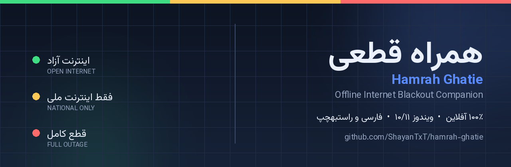
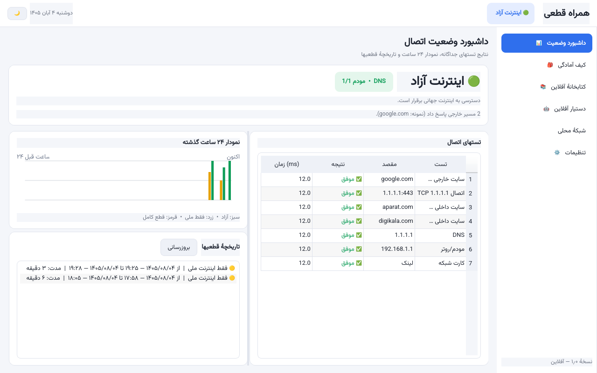
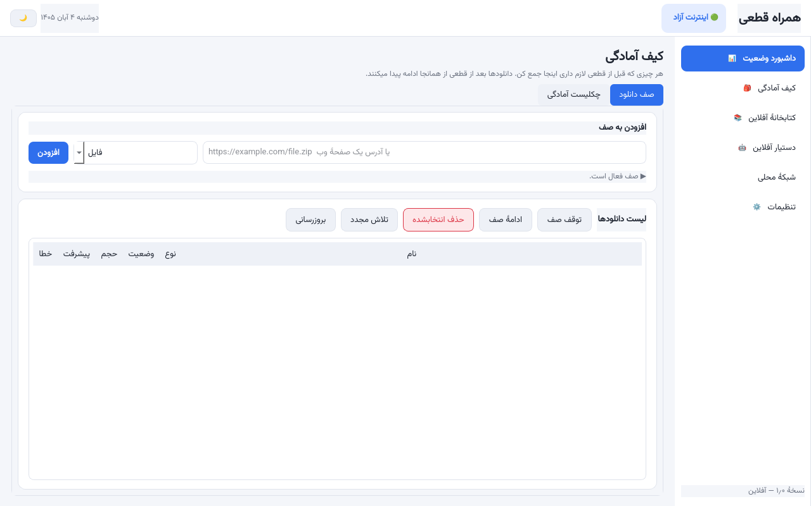
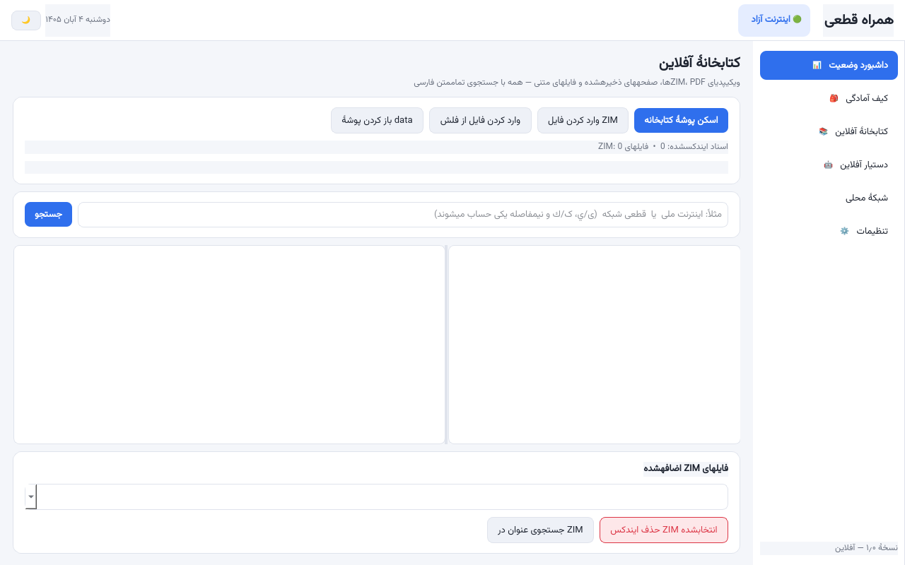
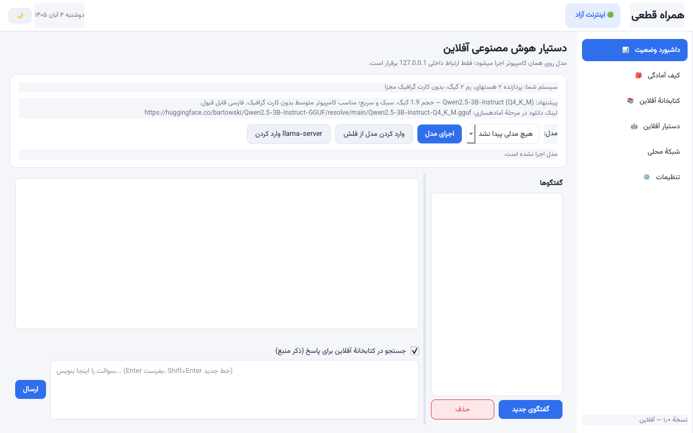
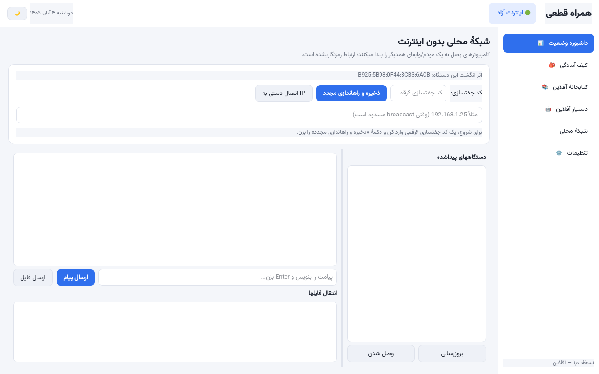
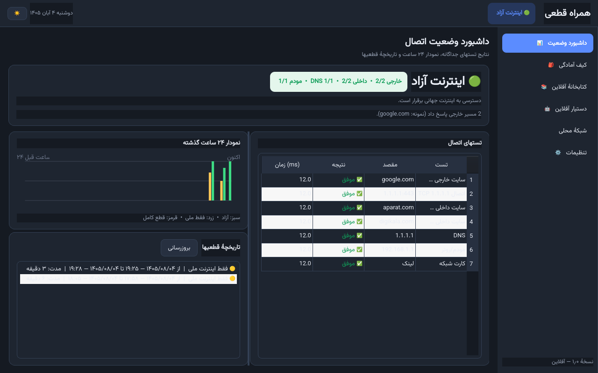

<div align="center">
  
</div>

<div align="center">

[](https://github.com/ShayanTxT/hamrah-ghatie/actions/workflows/ci.yml)
[](https://github.com/ShayanTxT/hamrah-ghatie/actions/workflows/build-windows.yml)
[](https://github.com/ShayanTxT/hamrah-ghatie/releases)
[](LICENSE)
[](https://www.python.org/)
[](https://www.microsoft.com/windows)
[](#offline-policy)

[🇮🇷 فارسی](README.fa.md) · **🇬🇧 English** · [Landing page](README.md)

</div>

# Hamrah Ghatie (همراه قطعی) 🟢🟡🔴

A **portable Windows desktop app** for the days when Iran's internet is cut
off or reduced to a "national intranet". After a one-time setup (while you
still have internet), it works **100% offline**: connectivity dashboard,
readiness kit, offline library, local AI assistant, and an encrypted LAN for
chat/file sharing.

- **Target OS:** Windows 10/11, 64-bit
- **UI:** fully Persian, RTL, Solar (Jalali) calendar, **bundled** Vazirmatn
  font, light/dark themes
- **Installation:** none. It is a folder you can run straight from a USB stick.
- **No CDN, no web fonts, no cloud API, no telemetry, no auto-update checks.**

> ⚠️ **Honest testing note (please read).** The development environment was
> Linux. The core logic (55 automated tests), the UI (rendered offscreen with
> the very same PySide6), reading a **real ZIM file**, an **encrypted file
> transfer between two real TCP peers**, and real HTTP downloads / page
> saving against a local server were all **actually executed and tested**.
> A **PyInstaller frozen build was also produced and run on Linux** (251 MB,
> font bundled). However, the **Windows `.exe` was not built or executed
> here** — `build.bat` and a `windows-latest` GitHub Actions workflow are
> provided to produce it. Full details in [What was tested](#what-was-actually-tested).

---

## Screenshots

| Dashboard (light) | Readiness kit | Offline library |
|:---:|:---:|:---:|
|  |  |  |

| AI assistant | LAN sharing | Dashboard (dark) |
|:---:|:---:|:---:|
|  |  |  |

These are **real screenshots** of the PySide6 UI (rendered offscreen).
Regenerate with `python tools/make_screenshots.py`.

---

## 1. Why Python 3.11 + PySide6?

| Criterion | Result |
|---|---|
| Persian / RTL support | Qt shapes Arabic/Persian text with HarfBuzz and `setLayoutDirection(RightToLeft)` flips the whole UI. Fonts can be embedded in the binary. |
| Size | Measured PyInstaller `onedir` output: **~250 MB** (without models/ZIMs and without optional `libzim`). Roughly half is Qt/ICU. Tauri is smaller, but FTS5, ZIM and crypto would have to be written from scratch. |
| RAM | The core has no Qt dependency; the window uses ~100–150 MB. The LLM only loads when you press the button. |
| Packaging | `PyInstaller --onedir` produces a complete folder that needs no install and no pre-installed Python. |
| Windows notifications | `QSystemTrayIcon` provides native notifications. |
| Everything else | SQLite FTS5 (Persian full-text search), `pypdf`, `cryptography`, `zstandard`, `psutil` — all small, offline-capable libraries. |

The core (`hamrah/core`) has **zero Qt imports** so it can be tested
independently; `hamrah/ui` is presentation only.

---

## 2. Project structure

```
hamrah-ghatie/
├─ run.py                       # run from source
├─ hamrah/
│  ├─ main.py, context.py       # entry point & service wiring
│  ├─ core/                     # pure logic (no Qt, fully testable)
│  │  ├─ probes.py, netcheck.py              # stage 1: probes & state machine
│  │  ├─ downloader.py, pagesaver.py, checklist.py   # stage 2
│  │  ├─ library.py, zim_reader.py, textutil.py, persian.py  # stage 3
│  │  ├─ sysinfo.py, llama.py                # stage 4
│  │  ├─ lan/                                # stage 5 (crypto, discovery, transfer)
│  │  ├─ db.py, config.py, jalali.py, http.py, netpolicy.py, errors.py
│  ├─ ui/                       # PySide6 pages & background workers
├─ assets/fonts/               # Vazirmatn (OFL) — bundled
├─ samples/                    # a real 14 MB ZIM for quick testing
├─ docs/screenshots/           # real UI screenshots
├─ tests/                      # 55 automated tests
├─ tools/prepare_downloads.py  # pre-blackout download script
├─ tools/make_banner.py, tools/make_screenshots.py
├─ build.bat / hamrah-ghatie.spec
├─ .github/workflows/{ci,build-windows}.yml
└─ data/                       # EVERYTHING lives here (next to the exe)
   ├─ app.db                  # history, download queue, search index, chats
   ├─ settings.json / identity.json / peers.json
   ├─ downloads/  pages/  library/  library/zim/  models/  bin/
   ├─ incoming/  exports/  tmp/  logs/
```

**Golden rule:** copying the whole folder (including `data`) moves the app,
settings, history, library and chats to another computer.

---

## 3. First setup

### A) Run from source (quick test, Windows or Linux)

```bat
:: Windows
python -m venv .venv
.venv\Scripts\activate
pip install -r requirements.txt
python run.py --demo --stage 1
```

```bash
# Linux / macOS (development only)
pip install -r requirements.txt
QT_QPA_PLATFORM=offscreen python3 run.py --demo
```

On Linux you may also need the system package `libxkbcommon0`.

### B) Build the portable Windows app

1. Install **Python 3.11 x64** (check "Add python.exe to PATH").
2. Run `build.bat`. It creates a venv, installs dependencies, runs the tests,
   builds `dist\همراه قطعی\`, places an empty `data/` next to the exe and
   writes a ZIP for your USB stick.
3. Output: `dist\همراه قطعی\HamrahGhatie.exe` — double-click it. No install,
   no internet and no Python required on the target machine.

**No Windows machine?** In GitHub, run the **Build Windows portable**
workflow (`Actions → Run workflow`); it builds on `windows-latest` and uploads
`hamrah-ghatie-portable-win-x64.zip` as an artifact (plus `SHA256SUMS.txt`).
Pushing a tag such as `v1.0.0` also automatically attaches the ZIP to a
GitHub Release.

> The Vazirmatn font is already in `assets/fonts` and gets bundled. The
> `models/` and `library/zim/` folders are intentionally empty to keep the
> download small.

### First run (while internet still works)

1. Open **Settings** → set a **6-digit pairing code** (use the same code on
   every computer).
2. Open **Offline library** → import `samples/wikipedia_climate_change_mini.zim`
   to verify the ZIM reader works.
3. Open **AI assistant** → import `llama-server.exe` and a GGUF model.
4. Download the files in the next section and **test everything once**.

---

## 4. What to download before the blackout?

All downloads are **manual and only happen during the preparation stage**.
Easiest path:

```bat
python tools\prepare_downloads.py --list
python tools\prepare_downloads.py --minimal
:: or pick your own:
python tools\prepare_downloads.py --preset zim-fa-mini --preset model-balanced --preset llama-cuda
```

The script writes into `data/`, downloads are **resumable**, and llama.cpp ZIPs
are extracted automatically. Sizes below are approximate for the pinned
versions (October 2026).

| File | Approx. size | Put it in | Notes |
|---|---:|---|---|
| `llama-b11901-bin-win-cpu-x64.zip` | 30 MB | `data/bin` | `llama-server.exe`, CPU build — use when there is no GPU |
| `llama-b11901-bin-win-cuda-12.4-x64.zip` | 250 MB | `data/bin` | CUDA build for NVIDIA GPUs (recommended for this machine) |
| `cudart-llama-bin-win-cuda-12.4-x64.zip` | 300 MB | `data/bin` | CUDA runtime DLLs for the package above |
| `Qwen2.5-3B-Instruct-Q4_K_M.gguf` | **1.9 GB** | `data/models` | Light model for an average 8 GB RAM PC |
| `Qwen2.5-7B-Instruct-Q4_K_M.gguf` | **4.7 GB** | `data/models` | ⭐ Main recommendation, much better Persian, fully on 8 GB VRAM |
| `Qwen2.5-14B-Instruct-Q4_K_M.gguf` | **9.0 GB** | `data/models` | Higher quality; half the layers fall back to CPU, slower |
| `wikipedia_fa_top_mini_2026-07a.zim` | **220 MB** | `data/library/zim` | Persian Wikipedia, top articles only (quick start) |
| `wikipedia_fa_all_mini_2026-10.zim` | **2.6 GB** | `data/library/zim` | ⭐ All Persian articles, light on images |
| `wikipedia_fa_top_maxi_2026-07a.zim` | **2.4 GB** | `data/library/zim` | Top Persian articles **with images** |
| `wikipedia_fa_all_nopic_2026-10.zim` | **6.4 GB** | `data/library/zim` | All articles, no images |
| `wikipedia_fa_all_maxi_2026-10.zim` | **13.8 GB** | `data/library/zim` | Complete Persian Wikipedia |
| `wikipedia_en_top_mini_2026-09.zim` | **300 MB** | `data/library/zim` | English Wikipedia, top articles |
| `wikipedia_en_top_maxi_2026-09.zim` | **7.0 GB** | `data/library/zim` | English top articles with images |
| `samples/*.zim` (included) | **14 MB** | this repo | Just for a quick test |
| Vazirmatn font | 250 KB | `assets/fonts` | ✅ Already bundled |

**Suggested minimum:** `llama-cuda` + `model-balanced` + `zim-fa-mini`
≈ **7.6 GB**. With only a 4 GB flash drive: 3B model + `zim-fa-top-mini` +
`llama-cpu` ≈ **2.2 GB**.

Links:
- Models: <https://huggingface.co/bartowski/Qwen2.5-7B-Instruct-GGUF>
  (single-file `Qwen2.5-7B-Instruct-Q4_K_M.gguf`; the official Qwen repos use
  multi-part shards, so bartowski's single file is used here)
- ZIMs: <https://download.kiwix.org/zim/wikipedia/> (filenames contain a date;
  pick the newest `..._mini_...` if it changed)
- llama.cpp: <https://github.com/ggml-org/llama.cpp/releases> → newest `b####`
  pre-release → `llama-b####-bin-win-cuda-12.4-x64.zip` (or `cpu-x64`).
  Pinned in the script: `b11901`.

### Model recommender

The **AI assistant** tab measures RAM, cores and VRAM:

- Less than 10 GB RAM and no GPU → **3B** (~2 GB, CPU)
- 16+ GB RAM or 6+ GB VRAM → **7B Q4_K_M** (4.7 GB)
- **This machine (32 GB DDR4 + 8 GB VRAM)** → 7B fully on GPU and fast; 14B
  also runs but slower with CPU offload.
- With a weak CPU/GPU it falls back to `-ngl 0` (CPU-only).

---

## 5. Importing from a USB drive / external disk

**Option 1 — inside the app (recommended):**
- Offline library → "Import ZIM file" → choose the file → it asks whether to
  **copy into `data`** or just register the path (choose copy if the USB stick
  will not stay attached).
- AI assistant → "Import model from USB" and "Import llama-server".
- Offline library → "Import file from USB" for PDF/HTML/TXT/MD/DOCX.

**Option 2 — command line (without opening the app):**

```bat
python tools\prepare_downloads.py --import-folder D:\
```

This copies `*.gguf` → `data/models`, `*.zim` → `data/library/zim`,
`llama-server.exe`/`*.dll` → `data/bin`, and text/PDF files →
`data/library/My files`. Then open the app and click "Scan library folder".

> After every import, **test once** (e.g. search "internet" in the library and
> ask one question in the assistant).

---

## 6. The five stages — and how to test each

All stages ship in one build, but `--stage N` shows only the first N stages so
you can test incrementally:

```bat
HamrahGhatie.exe --stage 1
HamrahGhatie.exe --stage 2
:: ...
HamrahGhatie.exe --stage 5
```

`--demo` simulates a full cycle (open → national only → full outage → return)
**without any network request**, so you can verify notifications and history:

```bat
HamrahGhatie.exe --demo --stage 1
```

Other flags: `--data-dir PATH`, `--offscreen` (developer only).

### Stage 1 — Connectivity dashboard
Every 10 seconds (configurable) it probes **separately**: Iranian sites
(aparat, digikala, irna), foreign destinations (google, cloudflare), raw TCP to
`1.1.1.1` / `8.8.8.8`, system DNS and raw UDP DNS to `1.1.1.1`, the
default gateway (modem/router), and the NIC link state. Result: 🟢 Open /
🟡 National only / 🔴 Full outage. Changes use **hysteresis** (two consecutive
samples) to avoid false alarms. History + 24-hour chart live on the same page;
Windows notifications fire on change, with a special "do your backlog now"
alert the moment global internet **returns**.

**Test:** run `--demo --stage 1` for ~40 seconds; you should see four states
and one row in the outage history.

### Stage 2 — Readiness kit
SQLite download queue with `*.part` files, `Range` and `If-Range`/ETag → a
download interrupted mid-transfer resumes from the exact byte. Web pages are
saved as `index.html` + `assets/` (images, CSS, JS, even `url()` inside CSS)
with links rewritten. An 18-item checklist is included, and you can add,
remove and tick your own items. On "national only" the queue pauses
automatically and resumes when open internet returns.

**Test:** add a file URL and a page URL; disconnect Wi-Fi mid-download (or use
`--demo`); after recovery the same file continues.

### Stage 3 — Offline library
A **native ZIM reader** (format v5/v6, zstd/xz/zlib/uncompressed clusters,
redirects, old and new namespaces) is built into the app — no Kiwix
installation needed (`libzim` is used as an optional fallback if present).
Full-text search over PDFs, saved HTML, TXT/MD/DOCX/EPUB and ZIM articles uses
**SQLite FTS5** with Persian normalization: `ی/ي`, `ک/ك`, ZWNJ, diacritics,
tatweel and Persian/Arabic/Latin digits are all treated as equivalent.

**Test:** import `samples/wikipedia_climate_change_mini.zim`, then search
`climate`. Also create a text file containing "اينترنت ملي" and search
"اینترنت ملی".

> For very large ZIMs, full-text indexing defaults to 5000 articles
> (configurable in `settings.json`); **title** search always queries the whole
> ZIM directly. Articles are displayed as plain text (no Wikipedia
> JS/templates).

### Stage 4 — Offline AI assistant
Runs a GGUF model with `llama-server.exe` (llama.cpp) **on the same machine**.
The only traffic is loopback to `127.0.0.1` (purpose `LOCAL_AI` in the network
policy; any non-loopback destination is blocked). Responses stream
token-by-token (SSE), chat history is stored in SQLite, and it can optionally
answer **from your offline library with citations**.

**Test:** import the model and `llama-server.exe` → "Run model" → ask
"Give me a summary about internet blackouts". Model log:
`data/logs/llama.log`.

### Stage 5 — LAN without internet
Computers on the same modem/Wi-Fi (even with no internet) discover each other
via **HMAC-signed UDP broadcast** using the pairing code. TCP traffic uses
X25519 key exchange + HKDF and **AES-256-GCM**; each device's static key is
pinned after first contact. Chat and **unlimited-size** file transfer resume
from the last byte using `*.part` files. Every incoming file requires an
explicit approval dialog (name + size + hash). If broadcast is blocked, enter
the peer's IP manually.

**Test:** run the app on two computers with the same 6-digit code; send a
message and a file; close one mid-transfer and reopen it — the file continues.

---

<a id="offline-policy"></a>

## 7. Offline guarantee & network policy

Every network request passes through a guard (`hamrah/core/netpolicy.py`) and
must declare one of these purposes:

| Purpose | When |
|---|---|
| `PROBE` | connectivity checks (every 10 s) |
| `DOWNLOAD` / `PAGE_ASSET` | only downloads/pages **you** started |
| `LOCAL_AI` | only `127.0.0.1` for llama-server (all other hosts blocked) |
| `LAN` | discovery and traffic inside the local subnet |

Nothing else is allowed. Tests also scan the source tree to make sure
`requests`, `httpx`, CDNs, analytics or Sentry never sneak in. The HTTP client
bypasses the system proxy by default so connectivity checks reflect reality
(configurable in Settings).

Errors are always **Persian and user-friendly**; the full technical traceback
goes to `data/logs/app.log` (rotating, 2 MB × 3).

---

## 8. Backup

- Settings → "Backup data folder (ZIP)".
- Or simply copy the entire app folder (including `data`) to a USB stick.
- Settings: `data/settings.json` — history/index: `data/app.db` — errors:
  `data/logs/`.

---

<a id="troubleshooting"></a>

## 9. Troubleshooting

| Problem | Fix |
|---|---|
| Won't start / no window | Open `data/logs/app.log`. If it mentions `MSVCP140.dll` or `VCRUNTIME`, install Microsoft "Visual C++ 2015-2022 Redistributable x64". Put the app in `Documents` or on a flash drive, not `C:\Program Files`. |
| "Cannot access file" | The folder is read-only. Copy the whole folder somewhere writable. |
| Windows SmartScreen warning | Expected (unsigned exe). "More info → Run anyway", and compare the hash with a build you made yourself. |
| Persian font looks broken / boxes | `assets/fonts/Vazirmatn-Regular.ttf` and `-Bold.ttf` must exist next to the bundle. Qt handles shaping itself. |
| Always 🔴 although internet works | Check the internal/external host lists in Settings; temporarily disable firewall/antivirus; if behind a proxy enable "Use system proxy". `app.log` shows the reason for each probe. |
| No Windows notification | Enable notifications in Windows, turn off Focus Assist, unhide the tray icon. The in-app toast always works. |
| Download doesn't resume | Server must return `206` for `Range`; if it returns `200` the file is safely restarted (shown in the item status). Do not delete `*.part`. Click "Resume queue". |
| Saved page has no images | Some sites lazy-load images with JavaScript; static pages work best. Default cap: 150 assets / 8 MB each (configurable). |
| ZIM won't open / "not a valid ZIM" | Incomplete download — re-download and verify the hash. For exotic future ZIM versions install optional `libzim` and rebuild. `app.log` logs the compression type. |
| ZIM indexing takes forever | Normal for multi-GB archives. Lower `zim_max_articles` or use a `top_mini` archive. Title search always remains instant. |
| Model won't start | Check `data/logs/llama.log`. Usually `llama-server.exe` is missing, wrong cpu/cuda build, or the model is incomplete. Lower `llama_ctx` to 2048 or try the 3B model. Keep CUDA DLLs in `data/bin`. |
| Model replies in English / nonsense | Use an `*Instruct*` model, lower temperature (0.5), ask clearly in Persian. |
| Peers can't find each other | Same pairing code, same subnet, firewall must allow the configured UDP/TCP ports, disable router "AP Isolation", or use manual IP. |
| "Device key changed" | One side reset its `data/`. Delete `data/peers.json` to re-pair. |
| Received file is incomplete | SHA-256 is verified; if it fails the `*.part` is kept and resumed next time (no rename). |
| Database locked / corrupt | Close the app, delete `app.db-wal` and `app.db-shm`, reopen. Restore `app.db` from backup if needed. |
| Slow on a flash drive | Old USB sticks are slow for SQLite/WAL. Put the folder on an internal disk and only import models/ZIMs from the stick. |

---

## 10. Limitations & security notes (honest)

1. **The Windows `.exe` was not built or tested here.** Source, `build.bat`,
   spec and Windows workflow are provided. Run `build.bat` on Windows once
   (it runs the tests too) and open the app.
2. **Windows tray notifications** (`QSystemTrayIcon`) can only be tested on
   Windows; offscreen I verified the in-app toast and history recording.
3. **A real GGUF model was not tested** (multi-GB model and GPU unavailable
   in the dev environment). SSE streaming, prompt building, RAG and history
   were tested against a fake `llama-server` on `127.0.0.1`. Test a real chat
   before the blackout.
4. The ZIM reader was tested against **one real ZIM** (v5, zstd clusters,
   20,565 entries): metadata, main page, redirects, title search, full-text
   indexing. Rare cases (v6 extended clusters, LZMA, multipart ZIMs) are
   implemented from the openZIM spec but not tested with real files.
5. The LAN crypto protocol (X25519 + PSK + AES-GCM) is **custom and
   unaudited**. Fine for a trusted home LAN; not a VPN/TLS replacement. Keep
   the pairing code secret.
6. ZIM articles are shown as plain text (no JS/templates).
7. `--demo` is for testing only and opens no sockets.
8. Optional `libzim` is **not bundled by default** (GPLv3). See
   [LICENSE-THIRD-PARTY.md](LICENSE-THIRD-PARTY.md).

### What was actually tested (Linux, 55 pytest tests)

- ✅ Solar calendar conversion (compared against `jdatetime` on 4000 random
  dates: zero mismatches)
- ✅ Persian normalization + FTS5 search: "اينترنت ملي" = "اینترنت ملی",
  "شبكه" = "شبکه", ZWNJ, diacritics, digits
- ✅ State classification, hysteresis, outage open/close, return notification
- ✅ Real connectivity probes against the internet (result: 🟢 Open, 5/5
  external)
- ✅ Download queue: `Range` resume, `200` fallback, pause on national, real
  HTTP download on a local server
- ✅ Web page saving with images/CSS and link rewriting (local HTTP server)
- ✅ ZIM reader on a real file + unified search indexing
- ✅ Key exchange, signed discovery, file approval, resume logic
- ✅ **Real chat + file transfer between two TCP peers** with hash verification
- ✅ SSE streaming, chat history, model recommendation
- ✅ Network policy: non-loopback LLM traffic blocked, source scan for
  CDN/telemetry
- ✅ PySide6 UI offscreen for `--stage 1..5`, light/dark themes, full `--demo`
  cycle with history persisted to SQLite
- ✅ **PyInstaller frozen build produced and executed** (Linux, 251 MB) with
  the font bundled and `data/` created next to the exe

**Not tested:** the Windows exe, Windows tray notifications, a real GGUF
model/GPU, visual font rendering, and PowerShell gateway detection on a real
Windows machine.

---

## 🔗 Project links

- 📦 **Repository:** <https://github.com/ShayanTxT/hamrah-ghatie>
- 🐛 **Issues / feature requests:** <https://github.com/ShayanTxT/hamrah-ghatie/issues>
- 💬 **Discussions:** <https://github.com/ShayanTxT/hamrah-ghatie/discussions>
- 📥 **Portable build:** <https://github.com/ShayanTxT/hamrah-ghatie/releases>
- 🤝 **[Contributing](CONTRIBUTING.md)** · **[Code of Conduct](CODE_OF_CONDUCT.md)** · **[Security](SECURITY.md)** · **[Support](SUPPORT.md)**
- 🏗️ **[Architecture](docs/ARCHITECTURE.md)** · **[Changelog](CHANGELOG.md)** · **[Third-party licenses](LICENSE-THIRD-PARTY.md)**
- ⚙️ **[GitHub repo setup checklist](.github/REPO_SETUP.md)**

Made by [**ShayanTxT**](https://github.com/ShayanTxT) (`shayan.txt`) ·
licensed under [MIT](LICENSE). If it helps you, give the repo a ⭐.
